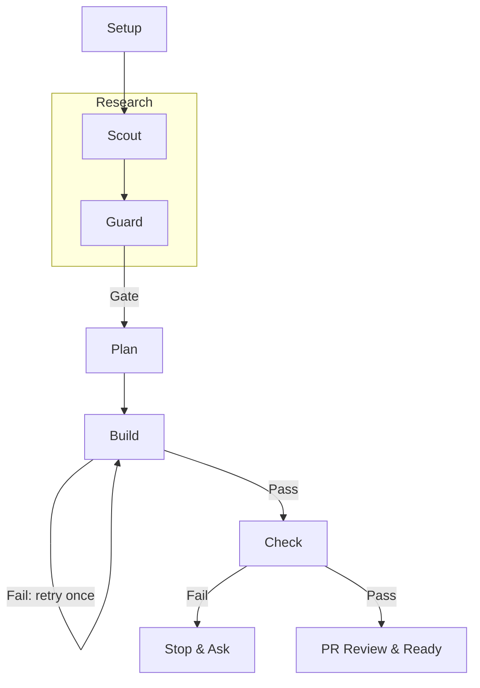
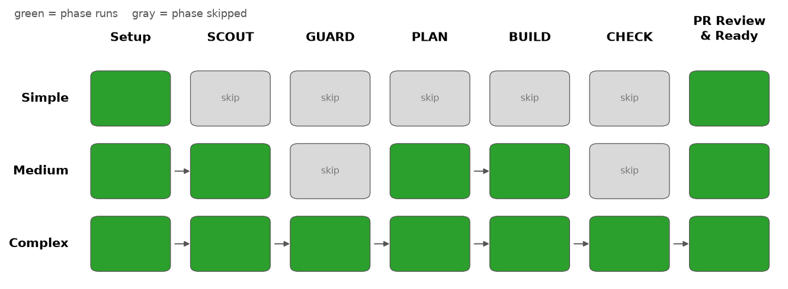
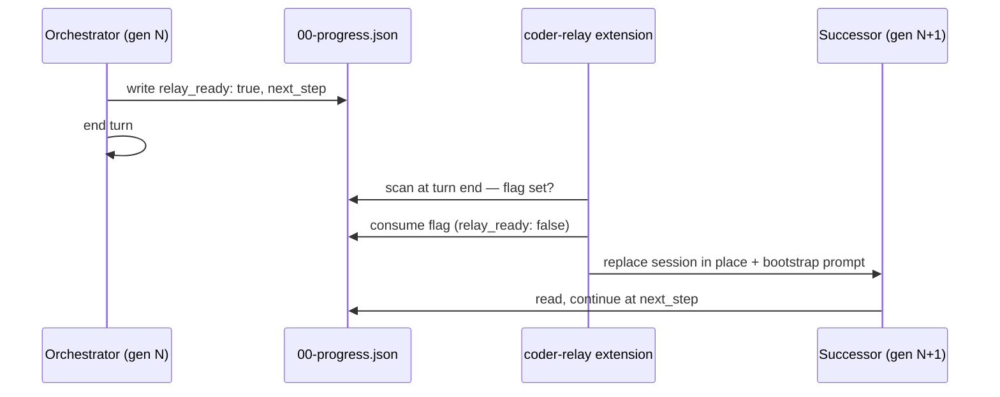

<p align="center">
  <a href="LICENSE"></a>
  <a href="https://conventionalcommits.org"></a>
  <a href="https://github.com/DavidAnson/markdownlint"></a>
</p>

<h1 align="center">agentic-coder-skill</h1>

<p align="center">A production Scout/Guard orchestration skill for AI coding agents.</p>

This is the `coder` skill: an orchestration layer that runs coding tasks through a
research-then-build pipeline with an adversarial review gate, delegating each phase to a
purpose-built subagent instead of doing the work inline. It has been in daily production
use since v1.0.0; this repo is the skill at its current version, with real commit
history, not a point-in-time snapshot.

Background: [Orchestrating AI Agents: A Subagent
Architecture](https://clouatre.ca/posts/orchestrating-ai-agents-subagent-architecture)
and [The AI SDLC Governance
Stack](https://clouatre.ca/posts/ai-sdlc-governance-stack). Model-selection
methodology: [llm-agent-experiments](https://github.com/clouatre-labs/llm-agent-experiments);
predecessor study of the Scout/Guard architecture:
[prompt-repetition-experiments](https://github.com/clouatre-labs/prompt-repetition-experiments).

## Quick start

Feed the skill a GitHub issue reference; name `coder skill` explicitly to make the invocation deterministic.

*Table 1: Choosing an invocation pattern (merge rates are observed from real
runs; see [Evidence](#evidence)).*

| Situation | Pattern | Observed merge rate |
|---|---|---|
| One issue | Single stream (below) | — |
| A few independent issues (≤ ~6) | One parallel stream per issue | 5/5 and 5/5 |
| A wide range | Triage first, split across sessions | 2/13 as one mega-run |

### One issue

*Code Snippet 1: Minimal invocation. The orchestrator classifies the change, runs
the pipeline at the matching tier, and opens a draft PR (see Table 2).*

```text
Fix issue 123 with coder skill.
```

The prompt needs two things: the issue reference and, if merge is wanted, an explicit merge request — the skill never merges on its own initiative. Everything else (fetching the latest code, the CI gate, inline review-comment handling) is built in and needs no prompt text.

### A few independent issues

Ask for one coder stream per issue. Each stream gets its own worktree and handoff directory and produces one independently reviewable PR.

*Code Snippet 2: Batch invocation. Five streams produced five merged PRs in about 1h42m with three human interventions (see [Evidence](#evidence)).*

```text
Fix issues 101-105 with coder skill parallel streams. Merge and rebase.
```

Once a merge is requested, the pipeline enforces a **CI gate**: after a PR is marked ready, the orchestrator watches `gh pr checks` asynchronously, re-runs BUILD+CHECK on red checks, and fetches and resolves inline review comments before merging. It also applies deterministic **merge ordering** across multiple PRs (dependency order inferred from issue cross-references and PR bases, with dependents rebased after each merge).

### A wide range

Let the session triage first, then split the work across sessions rather than one mega-run — for example, half the issues in this session, half in the next.

*Code Snippet 3: Triage-first invocation for a wide range.*

```text
Can we fix issues 120-132 in a single session, or a subset? Using parallel coder skill streams?
```

The mechanics behind these invocations — tier classification, handoffs,
constraints — are specified in [`skills/coder/SKILL.md`](skills/coder/SKILL.md).

## Evidence

Measured over two months of daily use on one maintainer's machine, September to October 2026:

- **95% of PRs merged:** 236 of 249, with a median of 16 minutes from PR open to merge.
- **$0.14 in model cost per PR opened**, across 185 formal coder runs, with 96% of input tokens served from cache.
- **88% of tier proposals confirmed** by the judge; the rest moved one tier up or down.

Full numbers, figures, caveats, and the scripts that regenerate them: [Pipeline telemetry](docs/evidence/2026-10-pipeline-stats.md). One annotated run, five issues in parallel: [Case study](docs/examples/2026-09-five-parallel-issues.md).

## Pipeline



*Figure 1: Scout/Guard/Build/Check pipeline for a complex-tier change; simple and
medium tiers skip delegates or skip GUARD/CHECK entirely. Every PR opens as a
draft and is marked ready only after the review gate approves.*

Before research begins, SCOUT runs a premise gate (Phase 0): the issue's premise is checked against repository evidence and labeled `sound`, `diverges`, or `falsified`, with a one-call judge confirm-ride. A falsified premise stops the pipeline before any build work; a divergence proceeds only with a recorded "Deviations from the issue" section in the PR body.

The orchestrator classifies every change into one of three tiers and scales the
pipeline accordingly — a one-line config change skips every delegate, while an
architectural change runs the full SCOUT + GUARD + BUILD + CHECK chain. Full
phase-by-phase detail, including the constraints each delegate operates under, lives in
[`skills/coder/SKILL.md`](skills/coder/SKILL.md) — that file is the spec, not just an entry point.

*Table 2: Tier classification and the pipeline each tier runs. Classification
is a propose/validate pair (see [typesafe-ai integration](#typesafe-ai-integration)).*

| Tier | Typical change (SKILL.md Constraint #2) | Pipeline |
|---|---|---|
| Simple | Config, docs, CI, single-file < 50 lines, no cross-repo research | Inline, no delegates; test/lint/format before commit |
| Medium | Multi-file docs, cross-repo reference, well-understood patterns, no new abstractions, code > 50 lines single- or multi-file | SCOUT → PLAN → BUILD → Ship step (draft PR + review, no GUARD/CHECK delegates) |
| Complex | Architectural decisions, new abstractions, security-sensitive | SCOUT → GUARD → PLAN → BUILD → CHECK |



*Figure 2: Phase execution per tier (data: SKILL.md Constraint #2). For the Simple
tier, implementation and PR are inline — no delegate runs; the regenerate script
is [`figures/fig-tier-pipeline.py`](figures/fig-tier-pipeline.py).*

*Table 3: Pipeline phases, the four subagents, and their model pins (sources:
`tools/agents/{pi,claude,goose,vibe}-*.yaml`). PLAN is authored by the orchestrator,
whose model is whatever the host session runs — this repo pins only the four
delegates.*

| Phase | Delegate | Model (pi / Claude Code) | Responsibility |
|---|---|---|---|
| SCOUT | `coder-scout` | `zai/glm-5.3-flash` / `sonnet` | Read-only research: relevant files, conventions, 2–3 candidate approaches |
| GUARD | `coder-guard` | `zai/glm-5.3-flash` / `haiku` | Adversarial review of Scout's output: risk, blast radius, safety ranking |
| PLAN | orchestrator | session model (not pinned here) | Implementation plan synthesizing Scout + Guard |
| BUILD | `coder-build` | `zai/glm-5.3-flash` / `sonnet` | Implements the plan, runs test/lint/format. Large plans shard deterministically into parallel worktree-isolated shards, each gated on shard-scoped test/lint (never the judge); only passing shards merge, and CHECK then validates the merged diff once |
| CHECK | `coder-check` | `zai/glm-5.3-flash` / `haiku` | Validates the diff against the plan; on PASS, commits and opens a draft PR |

## What's here

*Table 4: Repository layout — edit the sources, never the generated files.*

| Path | Description |
|---|---|
| `skills/coder/SKILL.md` | The skill itself — entry point, phase spec, and version history |
| `agents-shared/{coder-*,prose-polish}.md` | Shared agent bodies (harness-agnostic), the edit source |
| `tools/agents/{pi,claude,goose,vibe}-*.yaml` | Per-harness frontmatter templates: model, tools, effort |
| `agents/{pi,claude,goose,vibe}/*.md` (+ `agents/vibe/*.toml`, prompts) | Generated agent files (frontmatter + body) — do not hand-edit |
| `scripts/generate-coder-agents.sh` | Regenerates/validates the agent files (`--write` / `--check`) |
| `githooks/` | Local governance hooks: conventional commits, DCO sign-off, protected-branch enforcement, branch hygiene |

## One pipeline, five harnesses

`skills/coder/SKILL.md` is the single pipeline definition, compatible with five
harnesses: **pi**, **Claude Code**, **Codex**, **Goose**, and **Vibe**. Goose and
Codex consume `SKILL.md` directly (Codex renders no subagents); Vibe consumes
generated TOML subagents under `agents/vibe/` and inherits the session model.

The four coder subagents plus the `prose-polish` agent are defined once and rendered
per harness:

1. **Edit the sources**: `tools/agents/{pi,claude,goose,vibe}-<agent>.yaml` holds the
   harness frontmatter (model, tools, thinking, max_turns); `agents-shared/<agent>.md`
   holds the harness-agnostic body.
2. **Regenerate**: `scripts/generate-coder-agents.sh --write` concatenates
   frontmatter + body into `agents/pi/`, `agents/claude/`, and `agents/goose/`
   (markdown) and `agents/vibe/` (TOML + prompt).
3. **Validate**: `scripts/generate-coder-agents.sh --check` exits 1 on drift; CI runs
   it on every PR.

## typesafe-ai integration

Tier classification uses the `judge` tool of the `decisions-judge` MCP server: the
orchestrator proposes a tier from observable repo facts (file count, diff size,
docs-vs-code; see Table 2), and one `choice` question validates it; the answer is
final, clamped to the tier ladder. On judge unavailability or a `{fallback: true}`
envelope, the proposal stands and the log line is flagged as fallback. One JSONL
log line is attempted per session at
`${CODER_LOG_DIR:-$HOME/.local/state/var/coder-log}/<host>.jsonl`; logging
failures never block the pipeline.

The PLAN phase runs a **plan-completeness gate** on medium and complex tiers:
a deterministic pass over the plan's `external_facts` proposes `complete` or
`incomplete`, and one `judge` call validates it; a mechanical `incomplete`
confirmed by the judge sends the plan back for rework, and a warning-level
undeclared-facts advisory forces external claims to be declared in the PR body
(constants normative in `agents-shared/premise-gate.schema.json`,
`x-gate-rules.plan_completeness`). The gate is never fatal: on judge
unavailability the mechanical proposal stands.

All judgments transit `api.typesafe.ai`, a third-party service. The auth token
(`TYPESAFE_API_KEY`) is consumed by the MCP server from the shell environment
and never written to files or handoffs. The judge server itself is
[decisions-judge-mcp](https://github.com/clouatre-labs/decisions-judge-mcp);
this repo documents only the judge contract (see
[`skills/coder/SKILL.md`](skills/coder/SKILL.md), Constraints #9–#10 and
Handoff Validation).

## Handoff protocol

Every phase boundary is a JSON file on disk — no context is passed through chat
memory, and the orchestrator itself is stateless: `00-progress.json` is the single
source of pipeline truth, so a fresh successor process can take over at any relay.
The orchestrator writes, each delegate reads its predecessor's file and
writes its own:

*Table 5: The six handoff files. A missing handoff is re-spawned per the Retry Policy; the orchestrator never works inline as a fallback.*

| Handoff | Written by | Read by |
|---|---|---|
| `00-progress.json` | orchestrator | successor orchestrator, user |
| `01a-research-scout.json` | SCOUT | GUARD, orchestrator |
| `01b-research-guard.json` | GUARD | orchestrator |
| `02-plan.json` | orchestrator (PLAN) | BUILD |
| `03-build.json` | BUILD | CHECK, orchestrator |
| `04-validation.json` | CHECK | BUILD (on retry), orchestrator |

All files are written compact (`jq -c .`) and stored under
`<git-common-dir>/coder-handoffs/<session-id>/`, outside the session worktree so
worktree teardown cannot destroy them. Handoffs are checked for structural validity
with `jq empty` before use; a malformed or missing handoff is fatal and follows the
Retry Policy.

**Relay.** The orchestrator never carries pipeline state across a phase boundary in
its own context; `00-progress.json` is the sole source of truth. Takeover is
triggered by one discrete flag: the orchestrator writes `relay_ready: true` and ends
its turn. On pi, the `coder-relay` extension checks the flag at turn end, consumes
it, and replaces the session in place with a fresh successor that receives a
one-line bootstrap prompt — same window, fresh context, no orphan process. On other
clients (and headless pi), the successor is spawned detached with the same bootstrap
prompt. An interrupted pipeline still carrying the flag is surfaced at the next
session start with the exact resume command. Every takeover scan appends a decision
line to `.relay-log.jsonl`; circuit breakers (boot sanity, relay-count cap) are
unchanged. The full procedure, takeover modes, and circuit breakers are specified in
the Relay section of [`skills/coder/SKILL.md`](skills/coder/SKILL.md).



*Figure 3: Flag-based seamless relay. The extension consumes the flag before takeover, so a cancelled or failed replacement never re-triggers; in detached mode the scan-and-consume steps are performed by the harness (`nohup` spawn with the same bootstrap prompt).*

## Inspecting a session

*Code Snippet 4: Common inspection commands. Handoffs live outside the worktree, so
they survive worktree teardown and are visible from any checkout.*

```bash
# List sessions with each plan's overview and the pipeline's current step
for d in "$(git rev-parse --path-format=absolute --git-common-dir)"/coder-handoffs/*/; do
  printf '%s: ' "$(basename "$d")"; jq -r '.overview // empty' "$d/02-plan.json"
  jq -r '.next_step // empty' "$d/00-progress.json"
done

# Verify generated agents match their sources (what CI runs)
scripts/generate-coder-agents.sh --check

# Current skill version
grep '^version:' skills/coder/SKILL.md
```

## Githooks and local operation

The hooks in `githooks/` are local, opt-in tooling — the same conventions
`coder-check`'s commit/PR step assumes are in place. They are not exercised by CI.

```bash
git config core.hooksPath githooks   # or: scripts/bootstrap.sh
```

- `commit-msg` — Conventional Commits format, DCO sign-off, no `Co-authored-by:` trailers
- `pre-commit` — blocks direct commits to `main`/`master`/`release/*`; runs secret scanning with `betterleaks` (skipped when the binary is absent) and identity checks that expect a `signingkey` in the committer's `~/.gitconfig*` (without one, bypass with `--no-verify` or adapt the hook locally)
- `pre-push` — blocks direct pushes to protected branches
- `post-checkout` — prunes local branches whose remote tracking branch is gone, on
  checkout to `main`/`master`

Portability notes:

- `agents-shared/premise-gate.schema.json` carries an `$id` pointing at this repo's canonical location; adjust it if you fork.
- The premise-gate CI battery and coder-log validator used upstream are not bundled here; schema validity can be checked with `jq empty`.
- aptu integration is optional: the `aptu-*` GitHub workflows under `.github/` and the `aptu-coder` extension referenced by the skill and agents can be removed without affecting the pipeline's runtime dependencies.

## Tooling

*Table 6: Tooling requirements. Pipeline rows are runtime dependencies of a
coder session; BUILD rows run only when the change touches that language; repo
CI rows run on pull requests to `main`. Figures are regenerated with matplotlib
via `figures/fig-tier-pipeline.py`.*

| Tool | Scope | Used for |
|---|---|---|
| git 2.40+ | pipeline | worktrees, githooks, handoff storage under the common git dir |
| jq | pipeline | all handoff read/write (`jq -c .` compact form) and handoff validation (`jq empty`) |
| `gh` CLI | pipeline | issue/PR operations (Rule 3; PR creation is ship work — Rule 8) |
| `decisions-judge` MCP server (`decisions-judge-mcp`) | pipeline | tier classification via the `judge` tool (Choice question); npm package, source at clouatre-labs/decisions-judge-mcp |
| uv, ruff, pyright | BUILD (Python) | test/lint/typecheck per SKILL.md Tooling Reference |
| bun or pnpm, biome, vitest | BUILD (JS/TS) | test/lint/format per SKILL.md Tooling Reference |
| cargo, clippy, cargo-deny | BUILD (Rust) | build/test/lint/deny per SKILL.md Tooling Reference |
| markdownlint-cli2 | repo CI + local | CI via the markdownlint-cli2 GitHub Action on PRs; locally via `bunx markdownlint-cli2 "**/*.md"` |
| shellcheck | local | githooks lint (recommended, not enforced in CI) |

## License

[Apache 2.0](LICENSE)
