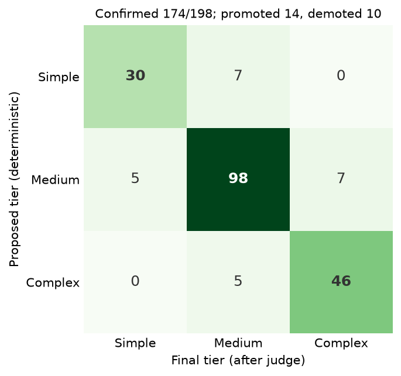
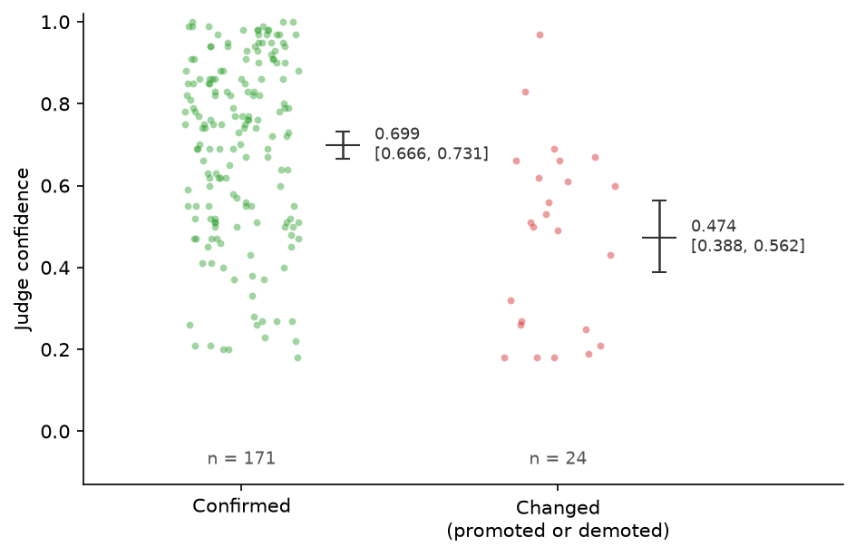
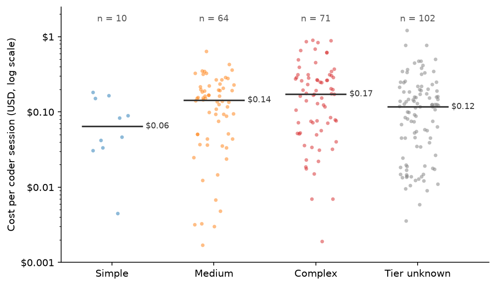

# Pipeline Telemetry: September to October 2026

This page summarizes one maintainer machine's coder usage from two sources:

- **Gate telemetry** (September to October 2026): the JSONL line the `coder`
  skill appends per gate decision to
  `${CODER_LOG_DIR:-$HOME/.local/state/var/coder-log}/<host>.jsonl` (SKILL.md
  Constraint #10), plus the CHECK verdicts in the session handoff directories
  still present on that machine; aggregate in
  [`coder-log-aggregate.json`](coder-log-aggregate.json).
- **pi session logs** (September to October 2026): per-message cost and token
  usage for coder sessions and their delegates, and the outcome of every PR
  those sessions opened; aggregate in
  [`pi-coder-aggregate.json`](pi-coder-aggregate.json).

Both aggregates contain counts, costs, percentiles, judge confidences, and model
names only: no session ids, paths, repository or owner names, hostnames, or
issue text.

## Gate outcomes

*Table 1: Decisions per gate. Premise and plan-completeness counts are log
lines; CHECK counts are `04-validation.json` files, by recorded `verdict`.*

| Gate | Outcomes | Total |
|---|---|---|
| Tier classification (judge) | 174 confirmed, 14 promoted, 10 demoted | 198 |
| Premise gate | 73 proceed, 3 soften, 2 stop | 78 |
| Plan completeness | 20 proceed | 20 |
| CHECK | 90 pass, 25 pass with notes, 11 fail, 9 request changes, 1 retry complete, 3 missing | 139 |

## Tier judge agreement

The orchestrator proposes a tier from repository facts with no LLM call, and one
`judge` call confirms, promotes, or demotes it. The judge confirmed 88% of the
proposals, and the changes ran in both directions. No change spans two tiers;
this follows from the design, since each judge answer moves the proposal at most
one step.



*Figure 1: Proposed tier (rows) against final tier after the judge (columns),
198 tier decisions; source
[`figures/fig-tier-agreement.py`](../../figures/fig-tier-agreement.py).*

## Judge confidence

When the judge changed a proposal, it reported lower confidence than when it
confirmed one: mean 0.474 against 0.699, with non-overlapping bootstrap 95%
CIs. The judge overrides the deterministic proposal mostly when it is less
certain.



*Figure 2: The `confidence` value returned with each tier decision, confirmed
(n = 171) against changed (n = 24), with mean and bootstrap 95% CI (10,000
resamples, seed 42); source
[`figures/fig-judge-confidence.py`](../../figures/fig-judge-confidence.py).*

## Cost

A coder session is a pi session that invoked the skill (read `SKILL.md`, or a
prompt naming the coder skill) and then spawned coder delegates or wrote coder
handoffs. Its cost is the orchestrator from the invocation onward plus every
delegate it spawned, as recorded by pi per message.

*Table 2: Cost of 247 coder sessions and their 871 delegate sessions.*

| Metric | Value |
|---|---|
| Total cost | $42.82 (bounds: $14.13 delegates only, $43.56 whole sessions) |
| Per coder session | median $0.13, p90 $0.36 |
| Per PR opened | $0.13 (325 PRs) |
| Tokens processed | 1.13 billion; 95.8% of input tokens served from cache |
| Model | `zai/glm-5.3-flash` on 99.8% of assistant messages |
| Excluded | 86 ad hoc delegate sessions spawned outside the skill ($1.36) |



*Figure 3: Cost per coder session by the highest tier among its runs, log
scale, with median bars; source
[`figures/fig-session-cost.py`](../../figures/fig-session-cost.py).*

## PR outcomes

PRs are the URLs printed by `gh pr create` in coder sessions plus the `pr_url`
in each `04-validation.json`. Outcomes were queried read-only from GitHub for
the maintainer's personal organizations.

*Table 3: Outcomes of PRs opened by coder sessions.*

| Metric | Value |
|---|---|
| PRs opened | 325 (321 queried; 4 in other organizations not queried) |
| Merged | 305 of 321 (95.0%); 16 closed without merge; 0 open |
| PR open to merge | median 0.24 h, p90 1.5 h |
| Merged PR size | median 3 files, +65/-9 lines; p90 11 files, +508/-72 lines |

## Scope and caveats

- One machine; the window spans several skill versions, and test or
  experimental sessions are not filtered out.
- Cost is pi's per-message cost from its configured per-token prices, not an
  invoice.
- A coder session is not a run: a relay successor starts a new session, and
  one session can run several issues in parallel streams, so cost per PR opened
  is the steadier unit. Tier per session is the highest tier among its handoff
  directories still on disk; 102 sessions have none.
- Coder sessions are identified heuristically (skill read or prompt naming the
  skill).
- Merging is the maintainer's decision, not an independent quality measure;
  the 16 closed PRs were not reviewed individually (some may be superseded).
- 6 of 591 log lines are malformed and skipped; 2 tier decisions with a final
  tier off the simple/medium/complex ladder are excluded from Figure 1, and 3
  without a numeric confidence from Figure 2.
- Judge confidence is the model's own reported value, not a calibrated
  probability.
- CHECK counts cover only handoff directories not yet removed by manual GC.

## Regenerate

*Code Snippet 1: Rebuild both aggregates and all figures; `--owners` takes the
GitHub owners whose PRs may be queried.*

```bash
scripts/coder-stats.sh > docs/evidence/coder-log-aggregate.json
uv run python scripts/pi-coder-stats.py --owners <owner>[,<owner>] > docs/evidence/pi-coder-aggregate.json
uv run --with matplotlib python figures/fig-tier-agreement.py
uv run --with matplotlib python figures/fig-judge-confidence.py
uv run --with matplotlib python figures/fig-session-cost.py
```
