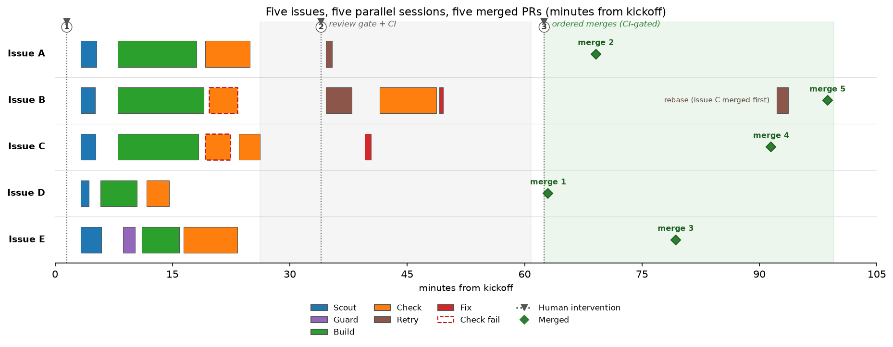

# Case Study: Five Refactoring Issues, One Orchestrated Run

In September 2026, the `coder` skill (v3.x, Scout/Guard architecture) processed five
refactoring issues in a Rust workspace in a single orchestrated run. The orchestrator
classified all five through the `decisions-judge` tier gate, ran five parallel
single-issue sessions with their own worktrees and handoff directories, and produced
five PRs: all approved by an external LLM review gate, CI green, and squash-merged in
dependency order. The run took about 1h42m, with 23 subagent spawns and 3 human
interventions, all approvals or steering and none of them rescues. The net result was
fewer lines of code.

The issues are labeled A to E below; the target repository is not named.

## The task

Five related refactoring issues in the same repository arrived as one request. That
raised an orchestration question: run all five through one session with parallel
BUILD, or isolate each issue? The orchestrator recommended five parallel single-issue
sessions, one worktree plus one handoff directory each, so each PR stays independently
reviewable and revertible. The user approved.

## How the pipeline ran

SETUP created five session ids, worktrees, and handoff directories under the shared
`.git/coder-handoffs/`, which survive worktree removal. Tier classification ran
through the judge per issue, with a classify JSONL log line per session.

*Table 1: The five sessions, their tiers, the phases they ran, and outcomes.*

| Issue | Tier | Phases | Outcome |
|-------|------|--------|---------|
| A | medium | SCOUT -> PLAN -> BUILD -> CHECK | Merged (duplicate field dropped) |
| B | medium | SCOUT -> PLAN -> BUILD -> CHECK (fail -> retry) | Merged (-99/+3 lines) |
| C | medium | SCOUT -> PLAN -> BUILD -> CHECK (fail -> retry) | Merged (minor version bump) |
| D | medium | SCOUT -> PLAN -> BUILD -> CHECK | Merged (legacy metrics directory deleted) |
| E | complex | SCOUT -> GUARD -> PLAN -> BUILD -> CHECK | Merged (shared telemetry preamble) |

The medium tier ran CHECK at PR time, as the skill did in v3.x; since v3.28 the medium
tier skips CHECK and ships through the orchestrator's Ship step instead. Issue E was
classified **complex** (a new abstraction: extracting a shared telemetry preamble), so
it got the full pipeline including GUARD.

Twenty-three subagent spawns in total (5 `coder-scout`, 1 `coder-guard`, 10
`coder-build`, 7 `coder-check`), most running in parallel in the background across
the five sessions.

*Figure 1: Agent activity across the five parallel sessions, in minutes from kickoff.
Both CHECK failures and every subsequent repair self-healed without blocking the
other lanes; the long quiet band is external wait (review gate and CI), not agent
work.*

## What went right

- **GUARD earned its keep on issue E.** The shared-preamble extraction looked like a
  mechanical unification of seven near-identical code blocks. GUARD flagged that the
  seven preambles were not fully identical: a naive merge would have changed command
  execution behavior. The plan and the build preserved the constraint. This is the
  difference between refactoring and silent behavior change.
- **Isolation paid off.** Five worktrees and five handoff directories meant one
  session's CHECK failure never blocked the other four. Issue C could fail and be
  repaired while the other sessions moved forward.
- **Net negative lines.** Issue B finished at -99/+3. The pipeline removed code
  rather than adding it, which is what a refactoring run should do.

## What went wrong, and self-healed

None of these were hidden, and each was surfaced with an honest attribution.

- **The orchestrator's own setup inconsistency failed CHECK on issue C.** A branch
  name mismatch introduced by the orchestrator during SETUP made `coder-check` fail.
  The failure was attributed to the orchestrator, not blamed on an agent, fixed with a
  branch rename, and CHECK then passed.
- **Issue B: code correct, tests missing.** `coder-check` flagged that the change was
  functionally correct but lacked tests. The orchestrator did not silently expand
  scope; it put an exact either/or to the user (add tests, or accept as-is) and
  proceeded after explicit approval.
- **Rate-limited review gate, fallback provider.** The external LLM review gate hit
  a rate limit mid-run. A fallback provider was authorized and used, so the gate
  stayed substantive rather than skipped.
- **Two semver CI failures.** Issues B and C changed public API surface (an enum
  discriminant and a public struct field), tripping semver checks in CI. A coordinated
  minor version bump resolved both: a legitimate version change, not a workaround.
- **One rebase.** The dependency-order merge required rebasing issue B's PR after
  issue C's merged; it was clean, with no conflict escalation.

## Human involvement

Three interventions in total, all approvals or steering. None was a rescue, meaning
none fixed something the pipeline had gotten wrong without reporting it:

1. Approve five parallel sessions over in-session parallel BUILD.
2. Authorize the fallback provider for the rate-limited review gate, then confirm
   "all PRs ready, CI green" to proceed to merge.
3. Authorize the ordered merge, with the rebase of issue B's PR.

Everything else ran without human touch: classification, research, guarding,
planning, building, checking, and retries.

## Takeaway

The value of the pipeline in this run was not that nothing failed: two CHECK
failures, a rate limit, a flaky CI test, two semver breaks, and a rebase all
happened. It was that a gate (CHECK, GUARD, CI, or the review gate) detected every
failure, attributed it honestly, and either the Retry Policy repaired it or the
orchestrator escalated it to the human as a precise question. Three approvals
bought five merged, reviewable, revertible refactoring PRs in under two hours.

Source: one pi session transcript, kept locally and not published;
[`figures/fig-session-timeline.py`](../../figures/fig-session-timeline.py)
regenerates Figure 1. For aggregate results across a month of sessions, see
[Pipeline telemetry](../evidence/2026-10-pipeline-stats.md).
